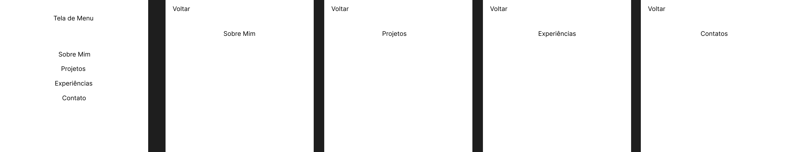

# Portfólio Profissional

**Aluno:** Felipe Henrique Moreira Jales  
**Curso:** Ciência da Computação (PUC Minas)  
**Disciplina:** Desenvolvimento de Interfaces Web (DIW)  
**Turno:** Manhã 
**Professor:** João Paulo Carneiro Aramuni

## 📖 Descrição do Projeto
Este projeto consiste no desenvolvimento de um website de portfólio profissional em formato *One-Page*. O objetivo principal é apresentar a trajetória, o foco de desenvolvimento na área de Dados e Inteligência Artificial (IA), bem como habilidades, projetos e formas de contacto. O projeto foi desenvolvido como parte dos requisitos do Laboratório 01. O sistema possui um design responsivo, com o tema visual "Dark Mode", e um formulário de contacto funcional integrado com o serviço EmailJS.

## 🔗 Link de Hospedagem
O site foi publicado utilizando o GitHub Pages e pode ser acedido através do link abaixo:
> **[https://felipehmjales.github.io/Portf-lio-Profissional/](https://felipehmjales.github.io/Portf-lio-Profissional/)**

## 🎨 Protótipos (Wireframes)
O planeamento visual e as interações de navegação foram desenvolvidos no Figma durante a Sprint 01.

* **Link para o protótipo interativo:** [Aceder ao Figma](https://www.figma.com/proto/BKvQghCuRgrpRtH6aGVEkX/Trabalho-TI--c%C3%B3pia-?node-id=2002-6&p=f&t=WvUbWInn5olLuksR-1&scaling=min-zoom&content-scaling=fixed&page-id=0%3A1&starting-point-node-id=2002%3A6)

*(Abaixo está a captura de ecrã da estrutura de navegação do protótipo)*


## 🛠️ Tecnologias Utilizadas
Abaixo estão listadas as tecnologias, frameworks e bibliotecas utilizadas no desenvolvimento deste projeto:

* **HTML5:** Estruturação semântica do conteúdo e secções da página.
* **CSS3:** Estilização, layout responsivo (Flexbox) e implementação de variáveis para o tema escuro.
* **JavaScript (Vanilla):** Lógica para validação de campos do formulário e manipulação do DOM.
* **EmailJS:** Serviço de API utilizado para o envio real de e-mails diretamente do front-end, sem a necessidade de um servidor back-end.
* **Figma:** Utilizado para a criação dos protótipos de interface e wireframes na fase de planeamento.
* **Git e GitHub:** Versionamento de código e alojamento do repositório.
* **GitHub Pages:** Plataforma escolhida para o *deploy* (hospedagem) gratuito do site estático na nuvem.

## 📁 Estrutura de Diretórios do Projeto
```text
/
├── index.html       # Arquivo principal contendo a estrutura, o conteúdo da página e os scripts do EmailJS
├── style.css        # Arquivo de estilos contendo o design (Dark Mode) e responsividade
├── DIW.png          # Imagem contendo o wireframe/protótipo inicial do projeto
└── README.md        # Documentação completa do projeto
